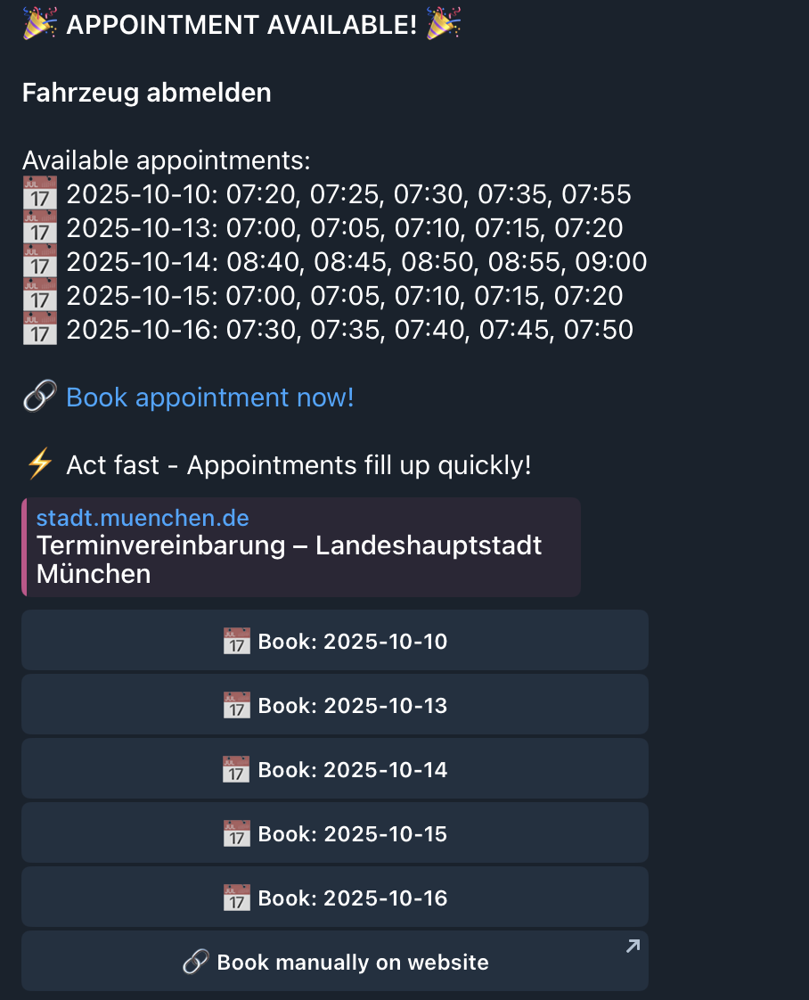

# Munich Appointment Bot

Telegram bot that monitors Munich city appointment system and notifies users when appointments become available.



## Features

- **Watches** - Up to 5 searches at once, each for one service, at one office or any office, with its own time:
  as soon as possible, within 2 weeks / 1 month / 3 months, before a date, or between two dates
- **Find by typing or browsing** - Type what you need ("passport", "Anmeldung", "паспорт") or pick a popular
  service or a category
- **Immediate check** - A new watch shows the current free days right away
- **One live alert per watch** - New free days arrive as one message with Book buttons; later changes edit it in
  place, and older alerts lose their buttons
- **In-chat booking** - Book a free time without leaving Telegram; your name and email can be reused next time
- **Menu at the bottom of the chat** - Find, My watches, Settings, Help
- **English and Russian**

## Quick Start

```bash
# Setup
cp .env.example .env
# Edit .env with your TELEGRAM_BOT_TOKEN

# Install dependencies
uv pip install --system -r pyproject.toml

# Initialize database
python3 -c "from src.database import init_database; init_database()"

# Run
python3 telegram_bot.py
```

## Configuration

Required:
- `TELEGRAM_BOT_TOKEN` - Get from @BotFather

Optional:
- `ADMIN_TELEGRAM_ID` - For health alerts

## Bot Commands

- `/start` - Register and get started
- `/find` - Find a Termin and start a watch
- `/watches` - My watches: change time, pause, resume, stop
- `/settings` - Language, saved booking details, deleting your data
- `/help` - How it works
- `/language` - Change language
- `/stop` - Delete all your data
- `/stats` - Bot statistics (admin only)

Older commands still work: `/menu` and `/subscribe` open Find; `/myservices`, `/status` and `/setdates` open
My watches.

## Architecture

Built with modern Python patterns:
- **Type-safe** - Pydantic models and dataclasses throughout
- **ORM** - SQLModel with repository pattern
- **Validated config** - Fails fast on startup errors
- **Background monitoring** - Continuous appointment checking with health monitoring

See `CLAUDE.md` for detailed architecture documentation.
